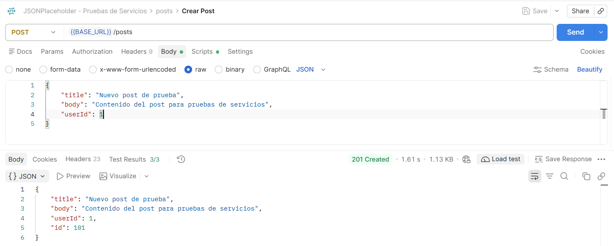
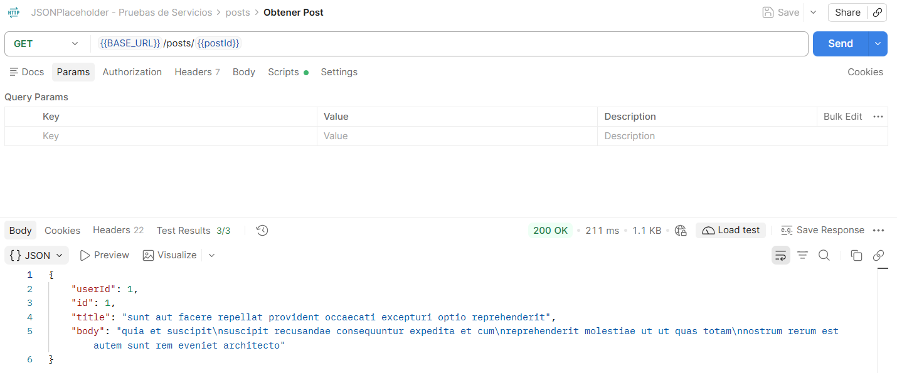
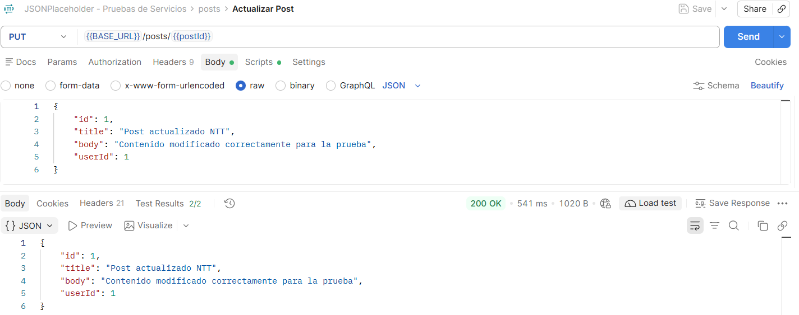
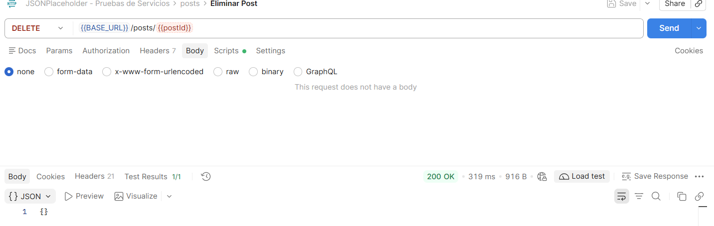

Durante la siguiente documentación se expone el uso del servicio API llamado JSONPlaceholder, su documentación se encuentra en el siguiente URL: [Documentación Oficial](https://jsonplaceholder.typicode.com/).


### Variables de Colección

| Variable | Valor                                |
| -------- | ------------------------------------ |
| BASE_URL | https://jsonplaceholder.typicode.com |
| postId   | 1                                    |


### Método POST:

| ENDPOINT | `{{BASE_URL}}/posts` |
| -------- | -------------------- |

Esquema:

```json
CreatePostDto 
{
  "title": "string",
  "body": "string",
  "userId": 1
}
```

Resultados:




### Método GET

| ENDPOINT | `{{BASE_URL}}/posts/{{postId}}` |
| -------- | ------------------------------- |
| postId   | 1                               |

Resultado:




### Método PUT

| ENDPOINT | `{{BASE_URL}}/posts/{{postId}}` |
| -------- | ------------------------------- |
| postId   | 1                               |

Esquema:

```json
UpdatePostDto 
{
  "id": 1,
  "title": "string",
  "body": "string",
  "userId": 1
}
```

Resultado:




### Método DELETE

| ENDPOINT | `{{BASE_URL}}/posts/{{postId}}` |
| -------- | ------------------------------- |
| postId   | 1                               |

Resultado:


